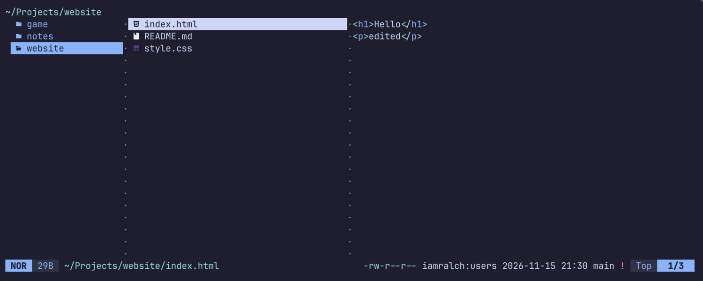

# starship.yazi

> A status line for Yazi with the path, owner and modification time, and optionally your starship prompt.

[](https://github.com/yazi-contrib/starship.yazi/actions/workflows/ci.yml) [](https://github.com/yazi-contrib/starship.yazi/releases) [](LICENSE)



## Dependencies

- [Yazi](https://yazi-rs.github.io) (the latest release)
- [starship](https://starship.rs) - only with `starship = true`

## Installation

```sh
ya pkg add yazi-contrib/starship
```

Or by hand, into the folder of your configuration of Yazi:

```sh
git clone https://github.com/yazi-contrib/starship.yazi ~/.config/yazi/plugins/starship.yazi
```

## Usage

In `init.lua`:

```lua
require("starship"):setup()
```

The status line shows the path of the hovered file on the left, and on the right the owner and the group, and
the modification time.

## Configuration

```lua
require("starship"):setup {
  starship = true,                                   -- the prompt of starship for the folder, off by default
  starship_config = "~/.config/starship/yazi.toml",  -- a STARSHIP_CONFIG of its own, optional
  owner = true,                                      -- the owner and the group
  mtime = true,                                      -- the modification time
}
```

| Option            | Default | Meaning                                                                  |
|-------------------|---------|--------------------------------------------------------------------------|
| `starship`        | `false` | Run `starship prompt` for the folder and show its output at the right    |
| `starship_config` | none    | The `STARSHIP_CONFIG` for that run, so that Yazi has a prompt of its own |
| `owner`           | `true`  | Show the owner and the group                                             |
| `mtime`           | `true`  | Show the modification time                                               |

The prompt is made again when the folder changes, not on every hover. A starship that is missing, or fails,
shows nothing.

## How it works, and what can break

The plugin changes `Status.name` and adds the segments to the right of `Status`. If a new release of Yazi
changes the status line, the plugin has to follow, so it is tested against the latest Yazi in CI.

## How it differs from starship.yazi by Rolv-Apneseth

There is another plugin with this name, [Rolv-Apneseth/starship.yazi](https://github.com/Rolv-Apneseth/starship.yazi).
They both can show a [starship](https://starship.rs) prompt in Yazi, and they do it in different places and for
different reasons.

| | [Rolv-Apneseth/starship.yazi](https://github.com/Rolv-Apneseth/starship.yazi) | yazi-contrib/starship.yazi (this one) |
|---|---|---|
| Where | The **header** line at the top, in place of the path | The **status line** at the bottom |
| What it is | A starship prompt plugin: the prompt is the whole point | A status line, where the prompt is an option, off by default |
| Without starship | Needs it | Works: the path of the hovered file, the owner and the modification time |
| Extras | The right prompt (`starship prompt --right`), Yazi's flags (filter, find, search) next to the prompt, count widget | The owner and group, the modification time, each of them can be switched off |
| Prompt of | The current folder, on every change | The current folder, made again when the folder changes |

Pick the other one if you want your starship prompt in the header, with its right prompt and Yazi's flags.
Pick this one if you want a status line at the bottom that shows the details of the hovered file, and perhaps
the prompt at its right.

**Both are named `starship`, so you cannot install both with `ya pkg`:** they use the same folder
(`plugins/starship.yazi`) and the same `require("starship")`. Install the one that you want.

## Development

```sh
nix develop
bats tests/
```

The tests start Yazi in a detached tmux session with a configuration of its own that loads the plugin from
this folder, and fail on an error of Lua, a deprecated API, or a start that does not hold.

## The yazi-contrib ecosystem

Plugins of Yazi, one repository for each: `viewer.yazi`, `layout.yazi`, `starship.yazi`, `finder.yazi`, `tailscale.yazi`.

## License

MIT
